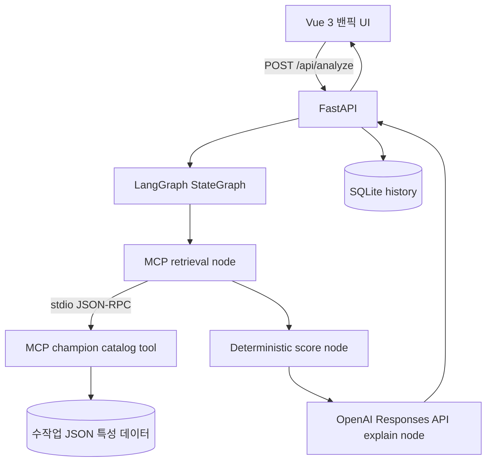

# 🎮 DraftWise AI — League of Legends 밴픽 전략 분석 Agent

> **교육용 AI Service Mini-Project** · Vue 3 + FastAPI + LangGraph + MCP + OpenAI Responses API

아군 픽·상대 픽·밴 챔피언·본인 챔피언 풀을 입력하면, **정량적 조합 점수**와 **AI 코치의 설명**을 받아볼 수 있는 웹 서비스입니다.

**프로젝트 방식:** 기존 서버 장애 진단 코드를 복사하지 않고 독립 개발. 다만 과제에 제시된 Vue/FastAPI/LangGraph/MCP/LLM 구성 및 역할은 그대로 구현했습니다. 과제 안내의 '제공된 ZIP 기반 재활용' 요건은 제출 담당자에게 재확인이 필요합니다.

## 주요 기능

1. **챔피언 픽·밴 빌더**: LoL 밴픽 스타일의 양 팀 슬롯과 중앙 챔피언 선택창. 아군 4명 / 적군 5명 / 팀별 밴 5명 / 주력픽 12명 입력. 슬롯별 선택·교체·제거, 동시 픽·밴 금지 및 중복 검증.
2. **정량 조합 분석**: 아군 AP/AD 편중, 탱커·CC 부족, 상대 진입 압력 및 포지션별 적합도 분석. 추천 픽을 선택하면 선택 전후의 피해 유형·앞라인·CC·진입·보호 챔피언 수를 비교.
3. **개인화 추천**: 상단에서 내 포지션을 선택하고 포지션별 주력 목록을 브라우저에 자동 저장. 숙련도(사용자가 선언한 주력픽 여부), 팀 조합, 상대 대응 점수를 가중 합산하여 추천 후보 3명 UI 및 상위 5개 API 반환.
4. **LLM 코치**: OpenAI API가 점수·근거를 바꾸지 않고 설명을 작성. 키가 없거나 API에 오류가 나면 규칙 기반 설명 사용.
5. **MCP 도구**: 별도의 MCP 서버에서 챔피언 데이터 조회. stdio Transport / FastMCP Tool + Resource.
6. **LangGraph**: `retrieve → score → explain` 그래프와 실행 trace.
7. **SQLite**: 세션별 분석 결과 저장, 조회 API. 화면에서 최근 10개 분석의 픽·밴 슬롯, 포지션, 설정과 저장 당시 결과를 복원.
8. **테스트**: 중복 픽, 밴 중복, AP 보완, 탱커 보완, 챔피언 풀 제한 및 API 테스트.

## 설치 및 실행 (macOS/Linux)

Python **3.11 이상** 필요. (3.12 권장)

```bash
cd draftwise-ai
python3 -m venv .venv
source .venv/bin/activate
pip install -r requirements.txt
cp .env.example .env
# .env 파일에 개인 OPENAI_API_KEY 입력
uvicorn app.main:app --reload --host 127.0.0.1 --port 8600
```

웹 브라우저: **http://localhost:8600**

- OpenAI API 키를 입력하지 않아도 밴픽 분석 및 데모 설명을 테스트할 수 있습니다.
- 실제 LLM을 쓰려면 `.env`의 `OPENAI_API_KEY=...` 설정 후 서버를 재시작하세요. API 호출 비용이 발생할 수 있습니다.
- API 키는 **백엔드에서만** 사용하며, HTML·자바스크립트에 삽입하지 않습니다. `.gitignore`에 `.env`가 포함돼 있습니다.
- Vue 3는 `static/vendor/`에 포함해 서버에서 직접 제공합니다. 폰트와 챔피언 이미지는 인터넷 CDN 연결이 필요하며, 이미지 연결 실패 시 기본 이미지로 대체합니다. 백엔드 챔피언 메타데이터/정량 분석은 네트워크 없이도 작동합니다.
- 제공 스크립트로도 실행할 수 있습니다: `bash run.sh`

내 포지션은 화면 상단에서 선택합니다. 중앙의 포지션 아이콘은 챔피언 목록 필터이며 내 포지션과 별개입니다. ‘내 주력’에서 등록한 목록은 포지션별로 저장되며, 초기화와 예시 조합은 선택한 포지션·주력 목록을 유지합니다. 포지션과 주력 설정은 같은 브라우저에서 유지되며 브라우저 저장소를 삭제하면 사라집니다.

‘이 픽으로 조합 비교’와 ‘최근 분석 불러오기’는 추가 OpenAI 호출 없이 동작합니다. 이력의 주력 목록은 복원한 분석에 적용하지만 현재 저장된 개인 주력 설정을 덮어쓰지 않습니다. 이전 버전에서 저장한 이력은 챔피언의 주 포지션을 기준으로 슬롯을 추정하며, 픽 전후 비교 정보가 없는 결과는 다시 분석해야 비교할 수 있습니다.

## 아키텍처



### 핵심 파일

| 파일 | 기능 |
|---|---|
| `static/index.html`, `style.css`, `app.js` | Vue 3 기반 반응형 웹 채팅/선택 UI |
| `app/main.py` | FastAPI / REST 엔드포인트 / 정적 서빙 |
| `app/agent.py` | LangGraph StateGraph (`retrieve`, `score`, `explain`) |
| `app/scoring.py` | 조합 분석, 후보 필터링, 가중 점수 |
| `app/llm.py` | OpenAI Responses API 연결 / 환각 억제 지시문 |
| `app/mcp_server.py`, `app/mcp_client.py` | MCP Tool/Resource 및 MCP 클라이언트 |
| `app/storage.py` | SQLite 분석 결과 저장 |
| `data/champions.json` | Data Dragon 16.21.1 기준 전체 173명의 수작업 특성 데이터 |
| `tests/`, `evaluate.py` | 회귀 테스트, baseline 비교 |

## API

| 메서드 | 경로 | 설명 |
|---|---|---|
| GET | `/api/health` | 상태 및 OpenAI 구성 여부 확인 |
| GET | `/api/champions` | 챔피언 데이터 조회 |
| POST | `/api/analyze` | 신규 밴픽 분석 요청 |
| GET | `/api/history/{session_id}` | 최근 10개 분석 이력 |

예시 요청:

```bash
curl -X POST http://127.0.0.1:8600/api/analyze \
  -H 'Content-Type: application/json' \
  -d '{"role":"JUNGLE","allies":["Yasuo","Jinx"],"enemies":["LeeSin","Ahri"],"pool":["Zyra","Ekko","Zac"],"style":"balanced"}'
```

## 추천 점수 설계

- `comfort` 40%, `team` 40%, `enemy` 20% (균형 설정 기준). 숙련도 우선 / 팀 조합 우선 모드에 따라 가중치 변경.
- **숙련도:** 사용자 주력픽 목록에 포함됐는지 여부를 대리 지표(proxy)로 사용. 실제 숙련도 API를 조회하지 않습니다.
- **팀 조합:** AP/AD 편중, 앞라인 부족, CC 부족, 야스오 연계 등 수작업 특성 점수.
- **포지션 적합도:** 팀 조합 점수 내부에 기존 조합 평가 80% + 포지션 평가 20%로 반영합니다. 탑은 앞라인·CC, 정글은 진입·CC, 미드는 피해 유형 균형·CC, 원딜은 상대 진입에 대응할 기동성·CC, 서포터는 아군 보호·교전 개시를 평가합니다. 실시간 라인 상성 통계는 사용하지 않습니다.
- **상대 대응:** 적 조합의 진입 및 앞라인 수를 감안한 일반 위험 대응. **챔피언 간 실제 카운터 승률이 아닙니다.**
- 픽·밴된 챔피언은 후보에서 제거; 후보가 없다면 0개 반환.
- LLM은 **정량 점수를 변경할 수 없으며** 설명만 생성합니다.

## 테스트

```bash
python -m pytest -q
python evaluate.py
# UI 슬롯 로직 회귀 검사 (Node.js 설치 시, 추가 패키지 불필요)
node --test tests/test_draft_ui.cjs
```

추천 테스트 시나리오:

| ID | 입력 조건 | 기대 결과 |
|---|---|---|
| T1 | 야스오·징크스 아군 / 정글 추천 | AP 편중 보완 추천 및 이유 제시 |
| T2 | 제이스·제드·징크스 아군 / 조합 우선 | 탱커·앞라인 우선 |
| T3 | 자이라 밴 | 자이라 미추천 |
| T4 | 아군/적군 챔피언 중복 | HTTP 422 |
| T5 | 챔피언 풀 1명 제한 | 목록 내 1명만 추천 |
| T6 | OPENAI_API_KEY 미설정 | 데모 모드로 안전한 설명 생성 |
| T7 | MCP Tool 조회 | MCP 패키지 설치 시 `mcp_stdio` 확인 |
| T8 | 상태 저장 | 생성된 `session_id` 이력 조회 |

### Before/After 설명

`evaluate.py`는 **가나다순 첫 챔피언 추천**이라는 단순 baseline과 DraftWise의 추천을 동일한 시나리오에서 비교합니다. 비교 대상은 후보와 휴리스틱 조합 점수일 뿐, 게임 승률·정확도 향상 수치를 입증하는 실험이 아닙니다. 통계적 유효성은 별도 실전 검증을 필요로 합니다.

## 한계 및 트레이드오프

1. **실전 메타 반영 X:** [Data Dragon 16.21.1 공식 목록](https://ddragon.leagueoflegends.com/cdn/16.21.1/data/ko_KR/champion.json)과 ID·한글 이름을 대조한 173명을 포함합니다. 포지션과 조합 특성은 수작업 교육용 분류이며, 신규 챔피언은 `data/create_roster.py`에 추가한 뒤 다시 생성해야 합니다. Data Dragon은 이미지·정적 정보를 제공하지만 패치별 승률까지 제공하지 않습니다.
2. **정량 점수는 휴리스틱:** 절대적인 승률이나 매치업 승패 확률이 아닙니다. 실제 승률과의 상관 검증은 미진행.
3. **API 비용·지연:** OpenAI API 사용 시 호출 비용 및 네트워크 지연 발생. 키 없음/실패 시 규칙형 설명으로 폴백.
4. **MCP stdio 프로세스 비용:** 요청마다 subprocess를 만들기 때문에 고트래픽 배포에는 지속 연결/풀링 필요.
5. **보안:** 익명 session_id만 이용하는 데모이며 사용자별 인증 없음. 외부 배포 시 인증·Rate Limit·CORS·입력 감사·비용 제한 추가 필요.
6. **CDN 종속성:** Vue 및 이미지 등은 인터넷 연결 필요.

## 실행 추적

정상 요청 반환 JSON의 `trace`는 다음과 같습니다.

```json
["validate_input", "mcp_retrieve", "rule_scoring", "llm_explanation"]
```

검증 시 `graph_mode=langgraph`, `mcp_mode=mcp_stdio`, `llm_mode=openai`를 확인해야 **실제 전체 경로**가 활성화된 것입니다. 의존성이나 API 키 누락 시 `*_fallback*`, `demo_no_api_key` 등의 정직한 상태값을 반환합니다.

## 배포 계획

우선 로컬 웹사이트로 시연(`localhost:8600`)하고, 이후 Render/Railway 등 Python 백엔드가 가능한 서버로 배포할 수 있습니다. GitHub에 API 키를 올리지 마세요.

## 발표 핵심 메시지

> "LLM이 모든 것을 추측하는 밴픽 챗봇 대신, MCP로 조합 특성 데이터를 조회하고 LangGraph로 정량 분석과 LLM 설명을 분리한 설명 가능한 추천 Agent를 개발했습니다."

이 프로젝트는 Riot Games로부터 승인 또는 보증받지 않은 독립적인 교육용 데모입니다.
