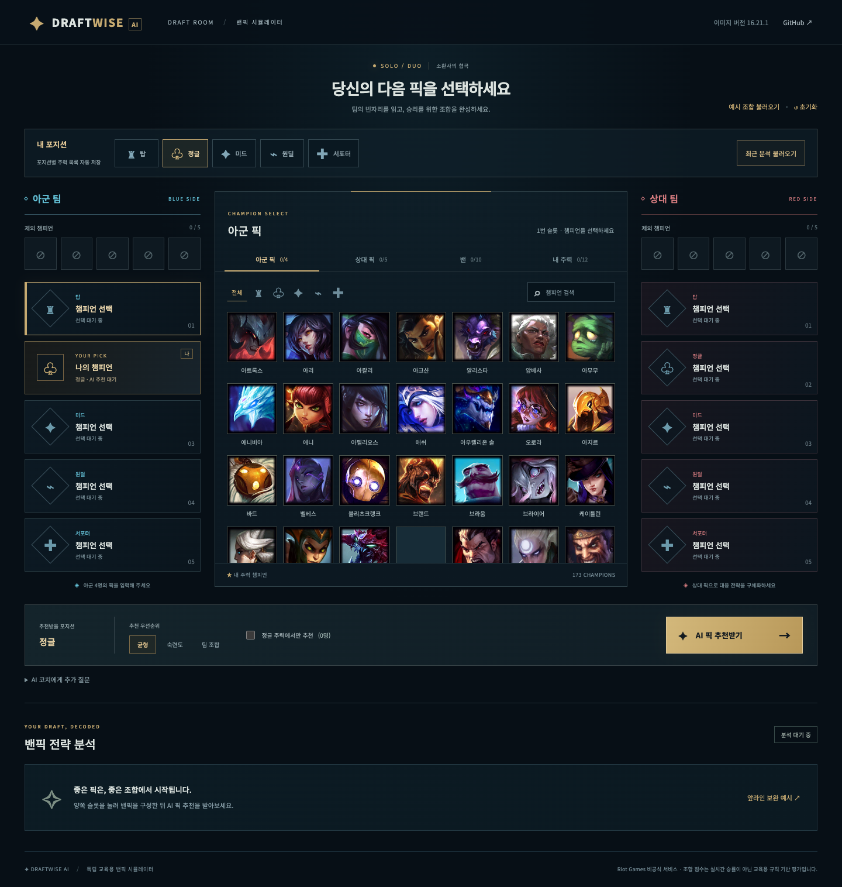
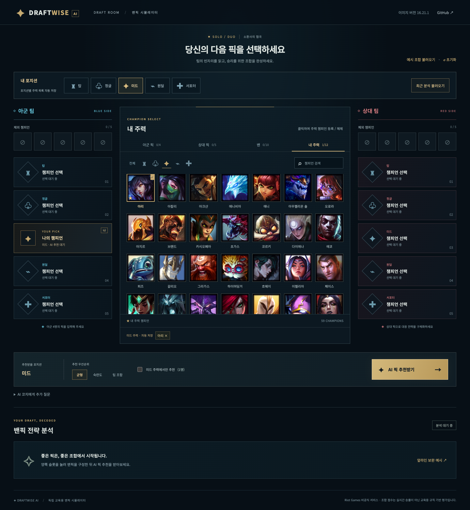
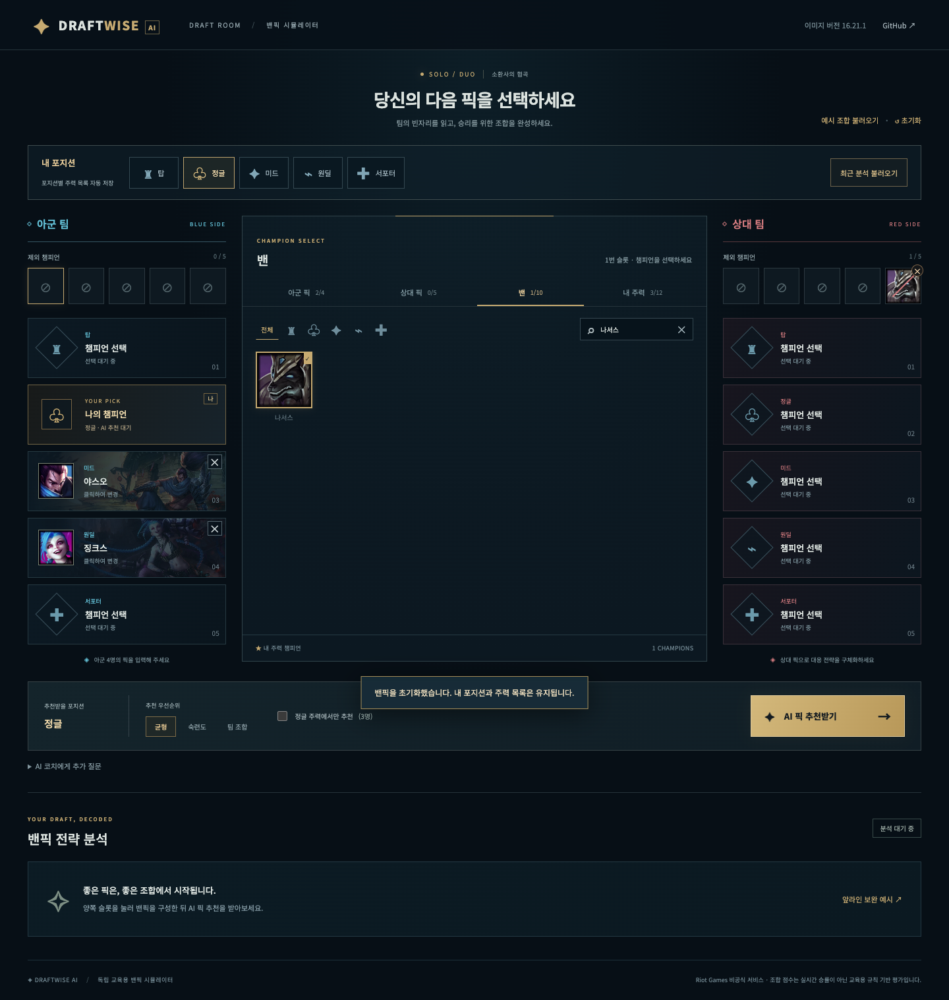
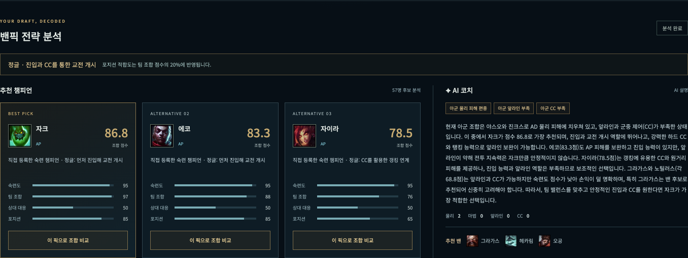
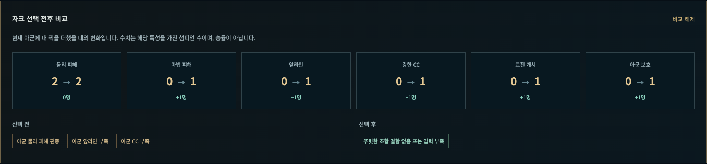

# DraftWise AI — SKALA Mini-project 최종 보고서

| 항목 | 기입 내용 |
|---|---|
| 번호 | **[번호를 기입하세요]** |
| 성함 | **[성함을 기입하세요]** |
| 프로젝트 | DraftWise AI — 설명 가능한 League of Legends 밴픽 분석 |
| 검증일 | 2026-10-22, 한국 시간(Asia/Seoul) |
| 저장소 | https://github.com/ii2001/DraftWise-AI |
| 발표 자료 | [5분 목표 발표 대본](PRESENTATION.md) |

> 고객 기능 추가 개발은 중단했다. 제출 검증 중 발견한 실제 밴/추천 밴의 설명 입력 혼동만 최소 수정했다. 이 보고서의 수치는 실행 로그에서 가져왔다. 실제 게임 승률, 통계적 정확도 또는 채점 점수를 측정한 결과가 아니다.

## 1. 프로젝트 개요와 해결하려는 문제

챔피언 티어표만으로는 아군의 물리·마법 피해 편중, 앞라인·CC 부족, 상대의 진입 압력과 사용자의 주력 챔피언을 동시에 판단하기 어렵다. 사용자가 아군·상대 픽, 밴, 포지션과 주력 목록을 입력하면 조합을 보완할 후보와 이유를 제시하는 교육용 의사결정 보조 웹서비스를 구현했다.

이번 범위에서 해결한 것은 **입력한 조합에 대한 일관된 후보 필터링, 조합 보완 점수, 근거 표시와 재현 가능한 기록**이다. 실제 경기 승률 예측, 라인별 카운터 통계, Riot 계정 전적 연동은 구현하지 않았다.

## 2. 최종 평가 기준과 제출 증거

사용자가 제공한 최종 평가표를 그대로 대응시켰다. 배점은 평가자의 기준이며, 아래 내용은 자체 채점이나 만점 보장이 아니다.

| 평가 항목 | 배점 | 구현·설명과 근거 |
|---|---:|---|
| 기능 구현 완성도 | 30 | 5개 포지션, 173명 선택·검색, 픽·밴 충돌 검증, 포지션별 주력 저장, 추천·비교·이력 복원. 20개 Python + 8개 Node 검사와 브라우저 12개 확인 |
| 기술 요소 반영 | 30 | Vue, FastAPI/Pydantic, LangGraph, 실제 MCP stdio Tool 호출, OpenAI Responses API, SQLite. 아래 기술 선택 이유와 실제 실행 모드 참조 |
| 한계 및 트레이드오프 설명 | 20 | 수작업 특성, 단순 Baseline, 속도·비용 구분, 익명 세션, MCP 프로세스 비용, 남은 AI 서술 오류를 명시 |
| 발표 자료 작성 및 발표 | 20 | 실제 화면과 연결한 5분 목표 대본·예상 질문 작성. 실제 발표와 5분 리허설은 아직 수행하지 않음 |
| Before/After 실측 비교 | 보너스 10 | 동일 4개 입력의 성공 건수와 계산 시간 원본 표본. Baseline 3/4, 개선 4/4. 속도 향상이나 실제 경기 승률 향상으로 해석하지 않음 |

## 3. 기술 요소와 선택 이유

| 기술 | 실제 역할과 선택 이유 | 이번에 확인한 범위 |
|---|---|---|
| Vue 3 | 선택 슬롯·필터·추천 결과를 반응형 상태로 연결. 프런트엔드 빌드 과정 없이 구동 | 로컬 번들 로드, 포지션별 저장, 재로딩, 선택·비교·이력 복원 |
| FastAPI + Pydantic | HTTP API·정적 화면 서빙과 신뢰 경계에서의 입력 검증 | 정상 요청과 충돌 요청 422, 슬롯/압축 목록 일치 검사 |
| LangGraph | `retrieve → score → explain` 단계와 상태·실행 추적을 명확히 구분 | 실제 `graph_mode=langgraph` 및 실행 trace |
| MCP / FastMCP | 챔피언 데이터를 별도 프로세스의 표준 Tool 인터페이스로 조회 | stdio 연결 후 `get_champion_catalog` 호출. 상세 Tool/Resource는 등록되어 있으나 이번 별도 호출 검증 대상은 아님 |
| OpenAI Responses API | 계산된 점수와 근거를 한국어 코치 설명으로 전달 | 실제 `gpt-4.1-mini` 호출. 호출 성공과 설명의 사실 정확성은 구분 |
| SQLite | 익명 세션별 요청·결과를 저장하고 최근 10개를 복원 | API 이력 조회 및 브라우저에서 설정·결과 복원 |
| JSON + Riot Data Dragon | 173명 ID·한글 이름과 교육용 조합 특성을 제공. 이미지는 Riot CDN 사용 | 로컬 173명 로딩·검사. 조합 특성은 Riot 공식 통계가 아님 |

모델이 스스로 MCP 도구를 선택하는 자율 Agent는 아니다. 애플리케이션이 정해진 LangGraph 단계에서 MCP를 호출한다. OpenAI에는 설명 생성을 맡기고 추천 순위·점수는 Python 코드가 결정한다. 프롬프트는 설명을 제한하는 지침이며 사실 정확성을 보장하는 검증기는 아니다.

## 4. 구현 결과와 처리 흐름

1. 상단에서 내 포지션을 선택한다. 포지션과 포지션별 주력 목록은 브라우저에 저장한다.
2. 아군 4명, 상대 5명, 팀별 밴 5명과 주력 최대 12명을 입력한다. 중복 픽·밴은 UI와 API에서 검증한다.
3. MCP가 로컬 챔피언 특성을 반환한다. 포지션과 픽·밴, 주력 제한으로 후보를 필터링한다.
4. 숙련도·팀 조합·상대 대응을 평가한다. 균형 설정은 40%/40%/20%이며 팀 조합 안에 기존 평가 80% + 포지션 적합도 20%를 반영한다. 숙련도는 실제 전적이 아니라 주력 등록 여부의 대리 지표다.
5. OpenAI가 점수·근거·추가 질문을 설명한다. 추가 질문은 설명에 반영하며 정량 순위 자체를 바꾸지 않는다. 키 미설정·호출 실패 시 규칙 설명을 반환하고 모드에 표시한다.
6. 상위 5명을 API로 반환하고 화면에는 3명을 표시한다. 후보 클릭으로 AP/AD·앞라인·CC·진입·보호의 선택 전후 변화를 비교한다. 비교는 추가 AI 호출을 하지 않는다.
7. SQLite에 저장하고 최근 분석에서 픽·밴 슬롯·포지션·설정·저장 당시 결과를 불러온다. 복원은 최신 개인 주력 설정을 덮어쓰지 않는다.

## 5. 실제 실행 화면

모두 실제 Chrome에서 웹사이트를 열고 찍은 PNG다. AI 결과는 실제 호출에서 반환된 내용을 그대로 표시했으며 설명 문구를 편집하지 않았다. 오류 주입 화면은 정상 실행 화면과 구분했다.

### 5.1 전체 밴픽 화면

### 5.2 포지션별 주력 저장

미드에 아리를, 정글에 자크를 저장하고 포지션 전환·새로고침 후 각 목록이 유지되는 것을 확인했다.

### 5.3 슬롯 입력과 밴

아군 픽과 상대 5번 밴 슬롯 입력·제거, 이미 픽한 챔피언의 중복 선택 차단을 확인했다. 이 캡처의 나서스 밴은 뒤에서 제거한 후 AI 분석했다.

### 5.4 실제 OpenAI 분석 결과

화면의 `AI 설명`은 실제 OpenAI 응답이다. 실행 모드는 [browser.json](docs/evidence/2026-10-22/browser.json)의 `ui_analysis.response`에서 확인할 수 있다. 화면이 표시됐다는 사실만으로 설명 전체가 정확하다고 판정하지 않았다.

### 5.5 추천 픽 선택 전후 비교

해당 실행에서 자크 선택 시 AP·앞라인·강한 CC·진입·보호 특성 보유 수가 각각 증가했다. 수치는 특성 보유 챔피언 수이며 승률이 아니다.

### 5.6 분석 이력 복원

이력을 불러올 때 API를 다시 호출해 설명을 생성하지 않았고, 복원 후 저장 당시 결과라는 안내가 표시되는 것을 확인했다.

### 5.7 모바일과 장애 조건

| 캡처 | 실제 확인 내용 |
|---|---|
| [모바일 390×844](docs/evidence/2026-10-22/screenshots/07-mobile.png) | 320/390/580/768/900/1024/1440px에서 문서 가로 넘침 없음. 실제 휴대폰 터치 테스트는 하지 않음 |
| [브라우저 외부 자산 차단](docs/evidence/2026-10-22/screenshots/08-external-assets-blocked.png) | 브라우저의 외부 폰트·이미지를 차단해도 로컬 Vue와 173명 목록이 표시됨. 서버의 OpenAI 네트워크를 차단한 시험은 아님 |
| [앱 스크립트 차단](docs/evidence/2026-10-22/screenshots/09-boot-recovery.png) | 로컬 앱 스크립트 요청을 의도적으로 차단했을 때 빈 화면 대신 복구 안내 표시 |

## 6. 테스트와 실제 통합 실행

### 6.1 환경과 원본 기록

- 검증 환경: macOS-26.6.2-arm64-arm-64bit / Apple M5 / Python 3.12.13 / Node v26.5.0 / Chrome 155.0.8059.86.
- 앱 기준 커밋: `78f4cdd3dd133591c1040650d88d16250eb4c31b`. 제출 중 `app/llm.py`의 입력 구분만 수정한 상태에서 최종 재검증했다. 이 최소 수정의 앱 소스 커밋은 `987eb08`이다. 실제 검증 파일 해시는 [tests.json](docs/evidence/2026-10-22/tests.json)과 [integration.json](docs/evidence/2026-10-22/integration.json)에 기록했다.
- 설치 라이브러리 버전: 같은 `tests.json`에 기록했다. 요구사항 파일의 버전 범위와 당시 실제 설치 버전은 다를 수 있다.
- API 키를 로그에 기록하지 않았으며 사용자 원본 DB 대신 `/tmp/draftwise-submission-20261022.sqlite3`, 포트 8602를 사용했다.

| 검사 | 실행 결과 | 원본 |
|---|---|---|
| Python `python -m pytest -q` | **20 passed**, 종료 코드 0 | [로그](docs/evidence/2026-10-22/python-tests.txt) |
| Node `node --test tests/test_draft_ui.cjs` | **8 passed**, 종료 코드 0 | [로그](docs/evidence/2026-10-22/node-tests.txt) |
| 실제 브라우저 점검 | **12개 확인**, 정상 페이지 JavaScript 오류 0개 | [로그](docs/evidence/2026-10-22/browser.txt), [JSON](docs/evidence/2026-10-22/browser.json) |
| 프롬프트 입력 회귀 검사 | 실제 밴/추천 밴 분리·원본 분석 불변 확인 | [로그](docs/evidence/2026-10-22/prompt-context-selfcheck.txt). 모의 클라이언트 검사이며 실제 API 증거는 아님 |

Python/Node 테스트는 실제 OpenAI 응답 품질을 검증하는 테스트가 아니다. Node 8개는 Vue 함수를 모의 주입한 로직 검사이며 실제 반응형 watcher와 DOM 동작은 별도의 Chrome 검사에서 확인했다. 부하·침투·실제 모바일 기기·모든 브라우저 조합 검사는 수행하지 않았다.

### 6.2 실제 OpenAI + LangGraph + MCP

최종 통합 실행은 아래 4건 모두 HTTP 200, `openai / langgraph / mcp_stdio`였고, 반환 추천 목록·점수는 동일 입력의 로컬 결정론적 계산 결과와 일치했다. 단순히 API 키가 설정됐다는 상태 확인만으로 통과 처리하지 않았다. SDK의 구성된 API origin도 `https://api.openai.com`임을 확인해 원본 JSON에 기록했다.

| 입력 | HTTP | LLM | 그래프 | MCP | 서버 보고 시간 | 클라이언트 HTTP 실측 |
|---|---:|---|---|---|---:|---:|
| S1 | 200 | `openai` | `langgraph` | `mcp_stdio` | 3002 ms | 3007.086 ms |
| S2 | 200 | `openai` | `langgraph` | `mcp_stdio` | 3315 ms | 3318.059 ms |
| S3 | 200 | `openai` | `langgraph` | `mcp_stdio` | 2974 ms | 2979.706 ms |
| S4 | 200 | `openai` | `langgraph` | `mcp_stdio` | 2892 ms | 2896.035 ms |

실행 trace: `validate_input → mcp_retrieve → rule_scoring → llm_explanation`.

서버 보고 시간은 Agent 실행까지이며 SQLite 저장·HTTP 전체 왕복 시간과 같지 않다. 4건의 HTTP 평균은 **3050.221 ms**이고, 최솟값·최댓값 및 원본 응답은 [integration.json](docs/evidence/2026-10-22/integration.json)에 있다. UI 버튼으로 수행한 별도 실제 분석 1건도 같은 세 모드였으며 브라우저 관측 시간은 **2437.472 ms**였다.

최종 실행 5회, 수정 전 실행 5회로 **이번 제출 준비에서 실제 OpenAI 호출 총 10회**를 수행했다. 토큰 사용량·정확한 과금액은 측정하지 않았다. 브라우저 검사 첫 시도는 주력 편집에서 유지된 정글 필터를 전체로 해제하지 않아 실패했으며 API 호출 전에 종료됐다. 자동화 절차를 수정했고 [실패 로그](docs/evidence/2026-10-22/attempts/browser-01.txt)도 보존했다.

### 6.3 실제 출력에서 발견한 오류와 남은 항목

초기 실제 출력 5개 중 4개에서 요청에 없는 그라가스를 이미 밴됐다고 설명하는 오류를 수동 확인했다. 기존 LLM 입력은 실제 요청의 밴 목록을 전달하지 않고 `analysis.bans`라는 이름으로 추천 밴을 전달하고 있었다. 실제 밴을 `confirmed_bans`, 추천 밴을 `suggested_bans`로 구분하고 주력 등록을 `declared_pool`로 명시하는 최소 수정을 했다. 수정 전 응답·화면을 [attempts/](docs/evidence/2026-10-22/attempts/)에 보존했다.

**수정 후에도 S4 실제 설명에서 “밴된 자크를 제외하고는”이라는 잘못된 문장이 남았다.** 입력 밴은 `Zyra`, `Ekko`이고 자크는 밴되지 않았으며 정량 1순위도 자크였다. 최종 5개 출력의 실제 밴 서술만 수동 점검한 결과 이 오류 1건이 남았다. 이것은 일반적인 AI 정확도 측정값이 아니며 다른 모든 설명이 사실에 맞는다는 의미도 아니다. [원본과 수동 검토 기록](docs/evidence/2026-10-22/explanation-review.json)에서 확인할 수 있다.

따라서 **실제 통합 실행·정량 필터링 통과**와 **자연어 설명의 사실 일치 미해결**을 구분한다. 프롬프트만으로 잘못된 서술을 완전히 막았다고 주장하지 않는다. 향후에는 설명을 입력·근거와 대조하고 불일치 시 규칙형 설명으로 전환하는 검증이 필요하지만 이번 제출 범위에서는 구현하지 않았다.

## 7. 동일 4개 입력의 Baseline / 개선 방식 실측 비교

### 7.1 방법과 성공 판정

Baseline은 실제 과거 서비스 버전이 아니라, 같은 포지션·픽·밴·주력 제한을 만족하는 후보 중 한글 이름 가나다순 첫 챔피언을 고르는 비교용 방식이다. 개선 방식은 현재 `draft_analysis` 전체를 실행한다. 두 방식에 같은 4개 `DraftRequest`와 같은 미리 로드한 173명 데이터를 사용했다.

성공 기준은 결과를 보고 바꾸지 않고 AP/AD 피해 보완, `tank >= 2`인 앞라인, 픽·밴 준수로 고정했다. 추천 점수의 높고 낮음으로 성공을 판정하지 않았다. 입력 원본과 판정 기준은 [benchmark.json](docs/evidence/2026-10-22/benchmark.json)의 각 `request`와 `criterion`에 있다. 통합 실행과도 `session_id`를 제외한 입력이 일치하는 것을 확인했다.

각 입력·방식마다 준비 실행 20회 후 200회, 총 1,600개 시간 표본을 측정했다. 두 방식의 순서를 번갈아 실행하고 `time.perf_counter_ns`로 로컬 선택·계산 구간만 측정했다. 요청 모델 생성·파일 읽기·HTTP·MCP·LangGraph·OpenAI는 제외했다. 200번 반복했다고 서로 다른 입력 200개를 검증한 것이 아니며 성공 건수의 분모는 **4**다.

### 7.2 결과

시간 단위는 ms이며 각 칸은 **중앙값 / p95**다.

| 동일 입력 | 사전 성공 기준 | Baseline 결과 | 개선 결과 | Baseline ms | 개선 ms |
|---|---|---|---|---:|---:|
| S1 AD 편중 / AP 정글 요청 | 픽·밴을 준수하며 AP 피해 보완 | 그라가스 / 성공 | 자크 / 성공 | 0.009229 / 0.012167 | 0.148605 / 0.198458 |
| S2 앞라인 부재 | 픽·밴을 준수하며 tank >= 2인 앞라인 보완 | 그라가스 / 성공 | 자크 / 성공 | 0.009125 / 0.011167 | 0.152625 / 0.186166 |
| S3 AP 편중 / AD 정글 요청 | 픽·밴을 준수하며 AD 피해 보완 | 그라가스 / 실패 | 바이 / 성공 | 0.009334 / 0.012000 | 0.153500 / 0.215917 |
| S4 밴 제한 | 자이라·에코 밴을 준수하며 AP 피해 보완 | 그라가스 / 성공 | 자크 / 성공 | 0.009417 / 0.011916 | 0.146292 / 0.191250 |

- 조합 보완 성공 건수: **Baseline 3/4 → 개선 방식 4/4**.
- 4개 입력별 중앙값의 산술 평균: **Baseline 0.009276 ms / 개선 0.150255 ms**. 전체 API 평균이나 전체 표본의 중앙값으로 표시한 값이 아니다.
- 개선 방식이 더 느렸다. Baseline은 단순 정렬·선택만 하고 개선 방식은 조합 점수, 추천 밴, 후보별 조합 비교 정보를 더 계산하므로 동일 작업량이 아니다. 속도 개선으로 주장하지 않는다.
- 앞의 6.2절은 MCP·LangGraph·OpenAI를 포함한 전체 경로의 별도 시간이다. 이 표의 작은 수치를 사용자 체감 AI 응답 시간으로 제시하지 않는다.
- Baseline도 그라가스를 통해 AP와 앞라인 조건을 대부분 만족했다. 4개 수작업 사례와 약한 기준선으로 서비스의 일반 성능이나 실제 게임 승률 향상을 증명할 수 없다.

원본 1,600개 시간 표본·평균·중앙값·p95: [benchmark.json](docs/evidence/2026-10-22/benchmark.json). 간략 출력: [benchmark.txt](docs/evidence/2026-10-22/benchmark.txt).

## 8. 한계와 트레이드오프

| 선택·한계 | 얻은 점 | 비용·남은 위험 |
|---|---|---|
| 수작업 특성·규칙 점수 | 근거와 점수가 일관되고 단위 검사가 가능 | 패치 메타·승률·개별 라인 카운터를 반영하지 않음 |
| LLM은 설명만 생성 | 모델의 자유 생성이 정량 순위를 직접 바꾸지 않음 | 실제 밴을 잘못 설명한 사례가 남음. 추가 질문도 순위에 반영되지 않음 |
| 주력 등록을 숙련도의 대리 지표로 사용 | 로그인·전적 조회 없이 개인화 | 실제 계정 숙련도·플레이 성과로 해석하면 안 됨 |
| 요청마다 MCP subprocess | 실제 Tool 경계와 데이터 제공 역할을 분리 | 프로세스 시작 비용. 고트래픽 성능은 미검증 |
| LangGraph 선형 그래프 | 단계·상태·trace를 명시 | 단순 순차 함수보다 구성 비용. 자율적 도구 선택·반복 계획은 구현하지 않음 |
| 실제 OpenAI와 규칙형 폴백 | 연결 실패에도 점수와 기본 설명 제공 가능 | 지연·비용·모델 수명·응답 변동. 최종 실제 실행에서 오류 폴백 상황을 강제로 만들지는 않음 |
| 익명 세션 + SQLite + localStorage | 시연·기록 복원이 간단하고 키는 서버에 보관 | 사용자 인증·세션 소유권 보장·비용 제한·Rate Limit 없음. 공개 운영 배포·동시 부하는 미검증 |
| 로컬 Vue·외부 이미지 | Vue CDN 장애 의존성 제거, 공식 이미지 활용 | 이미지·폰트는 외부 연결에 의존. 실제 AI 설명에는 서버 네트워크도 필요 |
| 4개 입력의 비교 | 빠르고 재현 가능한 사례 검증 | 독립 실전 데이터·다른 Baseline·통계적 유효성은 미검증 |

원본 ZIP을 재사용하지 않은 독립 구현이다. 기존 계획에 원본 ZIP 재사용 요구 확인 메모가 있었으나 이번에 제공된 최종 평가표에는 그 조건이 명시되지 않았다. 별도 과제 원문이 있다면 본인이 확인해야 하며 재사용 조건을 충족했다고 기록하지 않았다.

## 9. 느낀 점 — 본인 검토가 필요한 작성 초안

추천 순위와 설명 생성을 분리하니 규칙의 결과를 테스트하고 오류 위치를 좁힐 수 있었다. 같은 입력에 대한 점수의 재현성과 LLM 설명의 가독성은 서로 다른 검증 대상이었다. 실제 실행 전에는 문제가 없어 보였지만, 실제 응답을 읽어 보니 추천 밴을 확정 밴으로 해석하는 오류가 드러났다. 프롬프트를 명확하게 고치는 것만으로 모든 사실 오류가 사라지지는 않는다는 점도 확인했다.

또한 “더 많은 기능”과 “검증 가능한 완성도”는 같지 않았다. Baseline도 네 사례 중 세 사례를 통과했고 개선 방식의 로컬 계산 시간은 오히려 길었다. 이런 결과를 숨기지 않고 무엇을 개선했고 무엇을 증명하지 못했는지 구분하는 것이 기술 설명에서 중요했다. 다음 단계가 있다면 기능 수 확대보다 설명 검증, 데이터 품질과 더 넓은 평가 입력을 먼저 보강하는 것이 적절하다고 판단한다.

> 이 절은 구현·검증 기록에 근거한 작성 초안이다. 제출자는 본인의 실제 경험과 표현에 맞게 확인·수정해야 한다.

## 10. 제출 전 남은 확인과 재현 안내

- 번호·성함은 위 기입란에 본인이 입력해야 한다.
- 느낀 점 초안의 본인 경험 일치 여부 확인이 남아 있다.
- 5분 목표 대본은 작성했으나 실제 발화 시간을 재는 리허설과 실제 발표는 수행하지 않았다.
- 실제 밴에 대한 LLM 서술 오류 1건은 미해결 상태다. 이를 사실 정확성까지 검증 완료한 서비스라고 발표하면 안 된다.
- 별도 ZIP 재사용 요건과 교육기관 제출 포털의 등록·마감 준수 여부는 확인하지 않았다. GitHub 업로드와 교육기관 최종 제출은 별개다.

실행과 재검증 명령은 [README](README.md), 증거 파일과 분리 DB·포트 설명은 [검증 증거 안내](docs/evidence/2026-10-22/README.md), 최종 제출 확인은 [체크리스트](SUBMISSION_CHECKLIST.md)에 정리했다.

## 참고 자료

- [OpenAI Python SDK 공식 문서](https://developers.openai.com/api/reference/python): Responses API와 비동기 클라이언트 사용 확인.
- [OpenAI GPT-4.1 mini 공식 모델 문서](https://developers.openai.com/api/docs/models/gpt-4.1-mini): 사용한 모델의 공식 식별자 참고. 실제 이용 가능 여부는 이번 API 실행으로 별도 확인했다.
- [Riot Data Dragon 16.21.1 한국어 챔피언 목록](https://ddragon.leagueoflegends.com/cdn/16.21.1/data/ko_KR/champion.json): 챔피언 ID·이름 데이터 기준. 조합 특성 점수의 공식 출처는 아니다.
