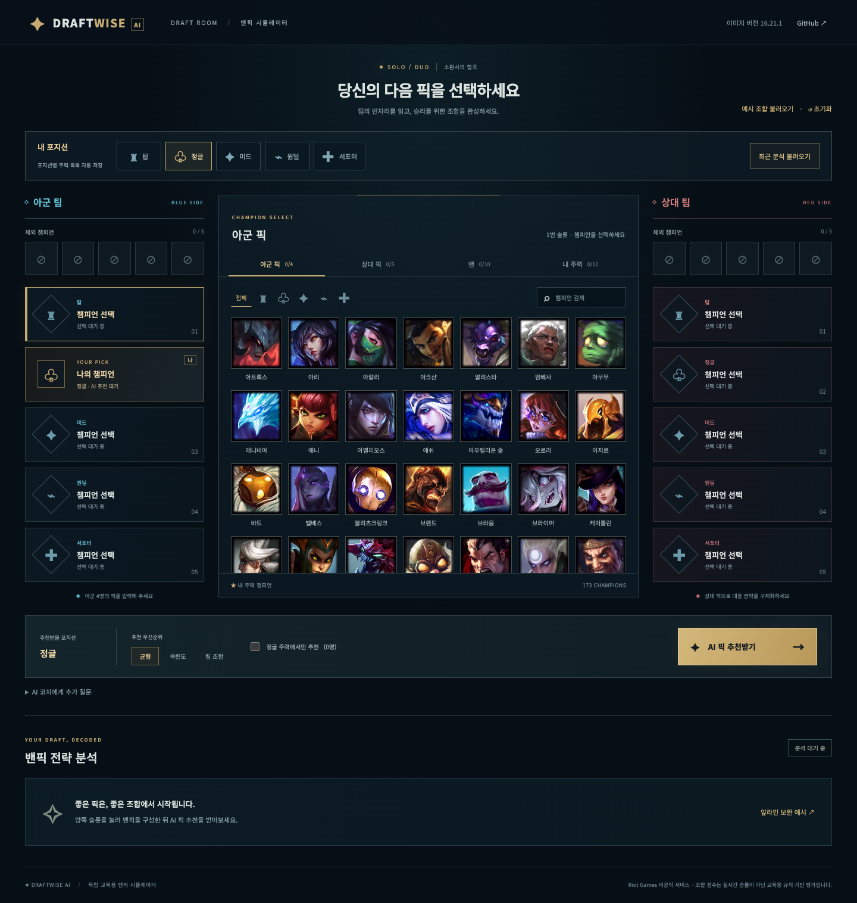
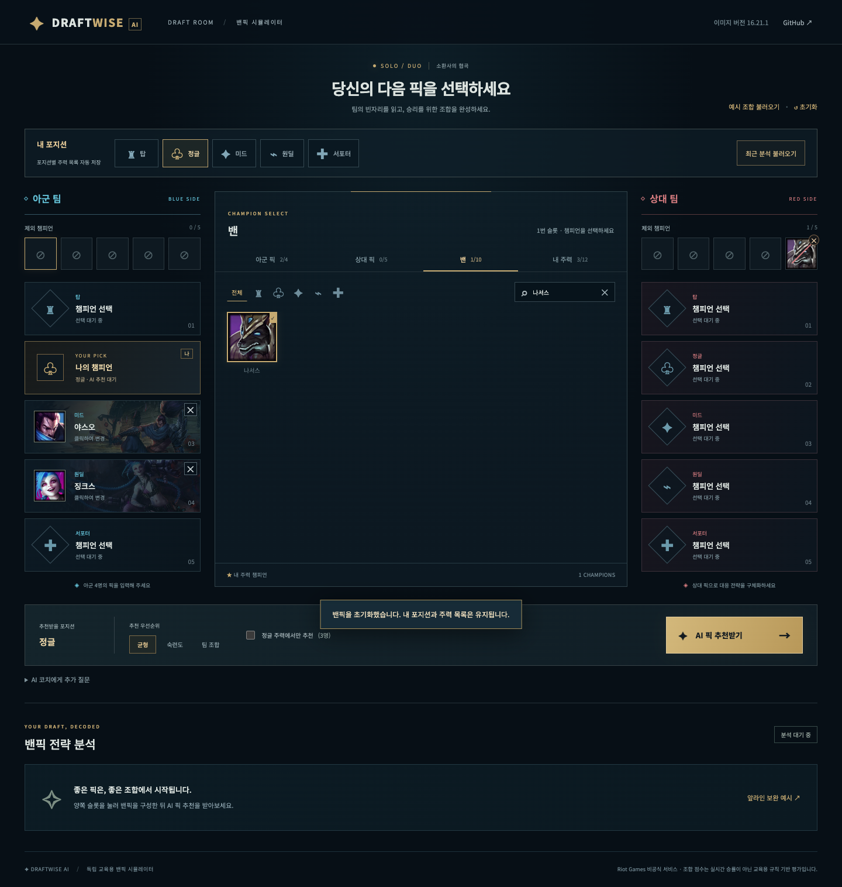
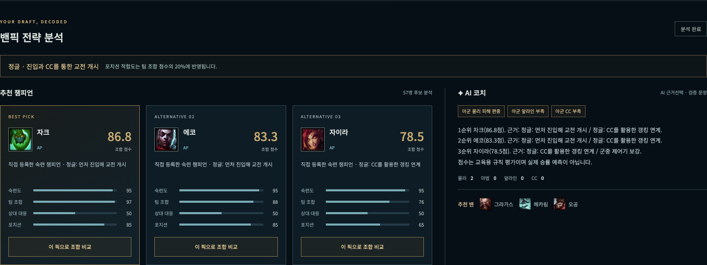
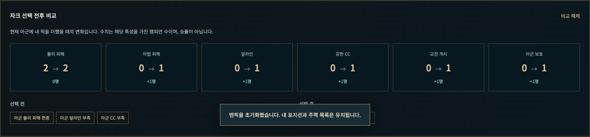
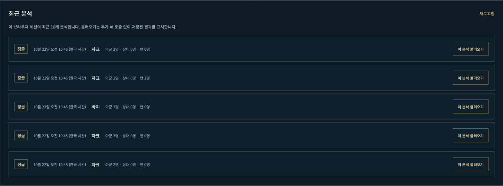

# DraftWise AI — SKALA Mini-project 최종 보고서

| 항목 | 기입 내용 |
|---|---|
| 번호 | **[번호를 기입하세요]** |
| 성함 | **김예찬** |
| 프로젝트 | DraftWise AI — 설명 가능한 League of Legends 밴픽 분석 |
| 검증일 | 2026-10-22, 한국 시간(Asia/Seoul) |
| 저장소 | https://github.com/ii2001/DraftWise-AI |
| 발표 자료 | [5분 목표 발표 대본](PRESENTATION.md) |

> 고객 기능 추가 개발은 중단했다. 제출 검증에서 발견한 AI 밴 설명 오류를 수정했다. 모델의 자유 서술 대신 제공된 근거 선택과 서버 검증 문장 조립을 사용한다. 이 보고서의 수치는 실행 로그에서 가져왔다. 실제 게임 승률, 통계적 정확도 또는 채점 점수를 측정한 결과가 아니다.

## 1. 프로젝트 개요와 해결하려는 문제

챔피언 티어표만으로는 아군의 물리·마법 피해 편중, 앞라인·CC 부족, 상대의 진입 압력과 사용자의 주력 챔피언을 동시에 판단하기 어렵다. 사용자가 아군·상대 픽, 밴, 포지션과 주력 목록을 입력하면 조합을 보완할 후보와 이유를 제시하는 교육용 의사결정 보조 웹서비스를 구현했다.

이번 범위에서 해결한 것은 **입력한 조합에 대한 일관된 후보 필터링, 조합 보완 점수, 근거 표시와 재현 가능한 기록**이다. 실제 경기 승률 예측, 라인별 카운터 통계, Riot 계정 전적 연동은 구현하지 않았다.

## 2. 최종 평가 기준과 제출 증거

사용자가 제공한 최종 평가표를 그대로 대응시켰다. 배점은 평가자의 기준이며, 아래 내용은 자체 채점이나 만점 보장이 아니다.

| 평가 항목 | 배점 | 구현·설명과 근거 |
|---|---:|---|
| 기능 구현 완성도 | 30 | 5개 포지션, 173명 선택·검색, 픽·밴 충돌 검증, 포지션별 주력 저장, 추천·비교·이력 복원. 기존 43개와 평가 회귀 3개를 합친 Python 46개 + Node 8개 검사, 브라우저 12개 및 이전 이력 보호 확인 |
| 기술 요소 반영 | 30 | Vue, FastAPI/Pydantic, LangGraph, 실제 MCP stdio Tool 호출, OpenAI Responses API, SQLite. 아래 기술 선택 이유와 실제 실행 모드 참조 |
| 한계 및 트레이드오프 설명 | 20 | 수작업 특성, 단순 Baseline, 속도·비용 구분, 익명 세션, MCP 프로세스 비용, 설명 오류의 원본·수정·검증 범위를 명시 |
| 발표 자료 작성 및 발표 | 20 | 실제 화면과 연결한 5분 목표 대본·예상 질문 작성. 실제 발표와 5분 리허설은 아직 수행하지 않음 |
| Before/After 실측 비교 | 보너스 10 | 같은 랜덤 밴픽 10개의 점수·완성 건수·시간 실측. 조합 완성도 90→95점, 완성 조합 6/10→8/10. 속도 향상이나 실제 경기 승률 향상으로 해석하지 않음 |

## 3. 기술 요소와 선택 이유

| 기술 | 실제 역할과 선택 이유 | 이번에 확인한 범위 |
|---|---|---|
| Vue 3 | 선택 슬롯·필터·추천 결과를 반응형 상태로 연결. 프런트엔드 빌드 과정 없이 구동 | 로컬 번들 로드, 포지션별 저장, 재로딩, 선택·비교·이력 복원 |
| FastAPI + Pydantic | HTTP API·정적 화면 서빙과 신뢰 경계에서의 입력 검증 | 정상 요청과 충돌 요청 422, 슬롯/압축 목록 일치 검사 |
| LangGraph | `retrieve → score → explain` 단계와 상태·실행 추적을 명확히 구분 | 실제 `graph_mode=langgraph` 및 실행 trace |
| MCP / FastMCP | 챔피언 데이터를 별도 프로세스의 표준 Tool 인터페이스로 조회 | stdio 연결 후 `get_champion_catalog` 호출. 상세 Tool/Resource는 등록되어 있으나 이번 별도 호출 검증 대상은 아님 |
| OpenAI Responses API | 제공된 근거 중 관련 항목을 선택하고 서버가 검증 후 문장 조립 | 실제 `gpt-4.1-mini`의 Structured Outputs 호출, 인덱스·개수·출처 검증 |
| SQLite | 익명 세션별 요청·결과를 저장하고 최근 10개를 복원 | API 이력 조회 및 브라우저에서 설정·결과 복원 |
| JSON + Riot Data Dragon | 173명 ID·한글 이름과 교육용 조합 특성을 제공. 이미지는 Riot CDN 사용 | 로컬 173명 로딩·검사. 조합 특성은 Riot 공식 통계가 아님 |

모델이 스스로 MCP 도구를 선택하는 자율 Agent는 아니다. 애플리케이션이 정해진 LangGraph 단계에서 MCP를 호출한다. 추천 순위·점수는 Python 코드가 결정한다. OpenAI는 후보별 근거 인덱스 1~2개만 선택한다. JSON Schema는 형식을 제한하고, 서버는 키·개수·정수 타입·중복·범위를 별도로 검사한다. 이름·점수·근거는 서버 데이터에서만 조립한다. 모델의 임의 밴 서술은 화면으로 전달되지 않는다. 이는 원본 수작업 데이터 자체의 정확성을 보장하는 것은 아니다.

## 4. 구현 결과와 처리 흐름

1. 상단에서 내 포지션을 선택한다. 포지션과 포지션별 주력 목록은 브라우저에 저장한다.
2. 아군 4명, 상대 5명, 팀별 밴 5명과 주력 최대 12명을 입력한다. 중복 픽·밴은 UI와 API에서 검증한다.
3. MCP가 로컬 챔피언 특성을 반환한다. 포지션과 픽·밴, 주력 제한으로 후보를 필터링한다.
4. 숙련도·팀 조합·상대 대응을 평가한다. 균형 설정은 40%/40%/20%이며 팀 조합 안에 기존 평가 80% + 포지션 적합도 20%를 반영한다. 숙련도는 실제 전적이 아니라 주력 등록 여부의 대리 지표다.
5. OpenAI가 조합·추가 질문을 고려해 기존 근거를 선택한다. 질문은 근거 선택에만 사용하고 자유 답변·정량 순위 변경은 하지 않는다. 검증 실패·키 미설정·호출 실패 시 규칙 설명으로 전환하고 모드에 표시한다.
6. 상위 5명을 API로 반환하고 화면에는 3명을 표시한다. 후보 클릭으로 AP/AD·앞라인·CC·진입·보호의 선택 전후 변화를 비교한다. 비교는 추가 AI 호출을 하지 않는다.
7. SQLite에 저장하고 최근 분석에서 픽·밴 슬롯·포지션·설정·저장 당시 결과를 불러온다. 이전 정책으로 저장된 설명은 조회 시 규칙 설명으로 대체하며 DB 원본은 보존한다. 복원은 최신 개인 주력 설정을 덮어쓰지 않는다.

## 5. 실제 실행 화면

모두 실제 Chrome에서 웹사이트를 열고 찍은 PNG다. AI 결과는 실제 호출의 근거 선택을 서버가 검증·조립한 API 응답을 그대로 표시했다. 캡처 후 문구를 편집하지 않았다. 오류 주입 화면은 정상 실행 화면과 구분했다.

### 5.1 전체 밴픽 화면

### 5.2 포지션별 주력 저장

미드에 아리를, 정글에 자크를 저장하고 포지션 전환·새로고침 후 각 목록이 유지되는 것을 확인했다.

### 5.3 슬롯 입력과 밴

아군 픽과 상대 5번 밴 슬롯 입력·제거, 이미 픽한 챔피언의 중복 선택 차단을 확인했다. 이 캡처의 나서스 밴은 뒤에서 제거한 후 AI 분석했다.

### 5.4 실제 OpenAI 분석 결과

화면의 `AI 근거선택 · 검증 문장`은 실제 OpenAI가 선택한 근거를 서버가 검증·조립한 결과다. 실행 모드는 [browser.json](docs/evidence/2026-10-22-grounding-fix/browser.json)의 `ui_analysis.response`에서 확인할 수 있다. 화면이 표시됐다는 사실만으로 설명 전체가 정확하다고 판정하지 않았다.

### 5.5 추천 픽 선택 전후 비교

해당 실행에서 자크 선택 시 AP·앞라인·강한 CC·진입·보호 특성 보유 수가 각각 증가했다. 수치는 특성 보유 챔피언 수이며 승률이 아니다.

### 5.6 분석 이력 복원

이력을 불러올 때 API를 다시 호출해 설명을 생성하지 않았고, 복원 후 저장 당시 결과라는 안내가 표시되는 것을 확인했다.

### 5.7 모바일과 장애 조건

| 캡처 | 실제 확인 내용 |
|---|---|
| [모바일 390×844](docs/evidence/2026-10-22-grounding-fix/screenshots/07-mobile.png) | 320/390/580/768/900/1024/1440px에서 문서 가로 넘침 없음. 실제 휴대폰 터치 테스트는 하지 않음 |
| [브라우저 외부 자산 차단](docs/evidence/2026-10-22-grounding-fix/screenshots/08-external-assets-blocked.png) | 브라우저의 외부 폰트·이미지를 차단해도 로컬 Vue와 173명 목록이 표시됨. 서버의 OpenAI 네트워크를 차단한 시험은 아님 |
| [앱 스크립트 차단](docs/evidence/2026-10-22-grounding-fix/screenshots/09-boot-recovery.png) | 로컬 앱 스크립트 요청을 의도적으로 차단했을 때 빈 화면 대신 복구 안내 표시 |

## 6. 테스트와 실제 통합 실행

### 6.1 환경과 원본 기록

- 검증 환경: macOS-26.6.2-arm64-arm-64bit / Apple M5 / Python 3.12.13 / Node v26.5.0 / Chrome 155.0.8059.86.
- 설명 검증 수정 커밋: `4fd0392`. 검사는 이전 커밋 `4c641e3`에서 이 수정이 적용된 작업 트리로 수행했다. 실제 검증 파일 해시는 [tests.json](docs/evidence/2026-10-22-grounding-fix/tests.json)과 [integration.json](docs/evidence/2026-10-22-grounding-fix/integration.json)에 기록했다.
- 최신 로컬 검사 기록: [tests.json](docs/evidence/2026-10-22-random-baseline/tests.json). 평가 코드만 바꾸었고 앱 추천 계산은 변경하지 않았다.
- 설치 라이브러리 버전: [최초 환경 기록](docs/evidence/2026-10-22/tests.json)에 기록했다. 이번 수정은 의존성을 추가하거나 변경하지 않았다. 요구사항 파일의 버전 범위와 당시 실제 설치 버전은 다를 수 있다.
- API 키를 로그에 기록하지 않았으며 사용자 원본 DB 대신 `/tmp/draftwise-submission-20261022.sqlite3`, 포트 8602를 사용했다.

| 검사 | 실행 결과 | 원본 |
|---|---|---|
| Python `python -m pytest -q` | **46 passed** (기존 43 + 평가 회귀 3), 종료 코드 0 | [로그](docs/evidence/2026-10-22-random-baseline/python-tests.txt) |
| Node `node --test tests/test_draft_ui.cjs` | **8 passed**, 종료 코드 0 | [로그](docs/evidence/2026-10-22-random-baseline/node-tests.txt) |
| 실제 브라우저 점검 | **12개 확인**, 정상 페이지 JavaScript 오류 0개 | [로그](docs/evidence/2026-10-22-grounding-fix/browser.txt), [JSON](docs/evidence/2026-10-22-grounding-fix/browser.json) |
| 입력·출력 계약 회귀 검사 | 실제 밴/추천 밴 분리·원본 분석 불변·구조화 요청 확인 | [로그](docs/evidence/2026-10-22-grounding-fix/prompt-context.txt). 모의 클라이언트 검사이며 실제 API 증거는 아님 |

Python에는 잘못된 밴 자유 서술·잘못된 인덱스·타입·중복·질문 주입, 실제 과거 출력 5개 재주입, 이전 이력 보호·DB 원본 보존 검사를 추가했다. 이는 모의 응답/회귀 검사이며 실제 API 호출과 구분한다. Python/Node 테스트는 모델의 일반적인 의미 정확도를 측정하는 테스트가 아니다. Node 8개는 Vue 함수를 모의 주입한 로직 검사이며 실제 반응형 watcher와 DOM 동작은 별도의 Chrome 검사에서 확인했다. 부하·침투·실제 모바일 기기·모든 브라우저 조합 검사는 수행하지 않았다.

### 6.2 실제 OpenAI + LangGraph + MCP

최종 통합 실행은 아래 4건 모두 HTTP 200, `openai / langgraph / mcp_stdio`였고, 반환 추천 목록·점수는 동일 입력의 로컬 결정론적 계산 결과와 일치했고, 출력 문장이 제공된 이름·점수·근거의 허용 조합과 정확히 일치하는지 검사했다. 4건 모두 `grounding_contract_passed=true`였다. 단순히 API 키가 설정됐다는 상태 확인만으로 통과 처리하지 않았다. SDK의 구성된 API origin도 `https://api.openai.com`임을 확인해 원본 JSON에 기록했다.

| 입력 | HTTP | LLM | 그래프 | MCP | 서버 보고 시간 | 클라이언트 HTTP 실측 |
|---|---:|---|---|---|---:|---:|
| S1 | 200 | `openai` | `langgraph` | `mcp_stdio` | 2191 ms | 2193.512 ms |
| S2 | 200 | `openai` | `langgraph` | `mcp_stdio` | 1065 ms | 1067.886 ms |
| S3 | 200 | `openai` | `langgraph` | `mcp_stdio` | 1223 ms | 1226.098 ms |
| S4 | 200 | `openai` | `langgraph` | `mcp_stdio` | 1285 ms | 1288.395 ms |

실행 trace: `validate_input → mcp_retrieve → rule_scoring → llm_explanation`.

서버 보고 시간은 Agent 실행까지이며 SQLite 저장·HTTP 전체 왕복 시간과 같지 않다. 4건의 HTTP 평균은 **1443.973 ms**이고, 최솟값·최댓값 및 원본 응답은 [integration.json](docs/evidence/2026-10-22-grounding-fix/integration.json)에 있다. UI 버튼으로 수행한 별도 실제 분석 1건도 같은 세 모드였으며 브라우저 관측 시간은 **1308.103 ms**였다.

이번 수정 후 통합 4회 + UI 1회, 이전 제출 준비 10회로 **누적 실제 OpenAI 호출 15회**를 수행했다. 토큰 사용량·정확한 과금액은 측정하지 않았다. 이전 브라우저 자동화 첫 실패는 API 호출 전에 종료됐으며 [실패 로그](docs/evidence/2026-10-22/attempts/browser-01.txt)는 보존했다.

### 6.3 AI 설명 오류 수정과 검증 범위

초기 실제 출력 5개 중 4개에서 추천 밴을 확정 밴으로 혼동했다. `confirmed_bans`와 `suggested_bans`를 구분한 첫 수정 후에도 5개 중 1개에서 “밴된 자크를 제외하고는”이라는 오류가 남았다. 당시 자크는 밴되지 않았고 정량 1순위였다. [당시 원본과 검토](docs/evidence/2026-10-22/explanation-review.json), [초기 실패 기록](docs/evidence/2026-10-22/attempts/)을 그대로 보존했다.

프롬프트 지시만으로 해결되지 않아 출력 경계를 수정했다. 모델은 상위 후보 각각에 대해 이미 계산된 근거의 인덱스만 반환한다. 서버가 형식·개수·인덱스 범위·중복을 검증한 다음 후보 이름·점수·해당 근거로 문장을 조립한다. 임의 챔피언 이름·밴 상태·자유 서술은 허용하지 않는다. 유효하지 않은 응답은 `fallback_invalid_explanation`으로 표시하고 규칙 설명으로 전환한다.

- 수정 후 실제 API 4건과 UI 1건은 모두 `openai / langgraph / mcp_stdio`, `explanation_policy=validated_evidence_v1`였고 제공된 근거 문장만 출력됐다. 잘못된 자크 밴 서술은 재발하지 않았다. 이 5건을 일반적인 의미 정확도 100%로 해석하지 않는다.
- 이전 실제 출력 5개를 재주입했을 때 자유 서술을 모두 거부하고 규칙 설명으로 전환하는 회귀 검사가 통과했다. 이 재주입은 실제 API를 다시 호출한 것이 아니다.
- 실제 이전 세션의 저장 기록 5개를 조회해 설명이 보호되는지 확인했다. 문제가 있던 S4를 브라우저에서 복원했을 때 자크를 정상 1순위로 설명하고 `이전 설명 보호 · 규칙 설명` 안내를 표시했다. 추가 모델 호출은 0회다. [검사 원본](docs/evidence/2026-10-22-grounding-fix/legacy-history-check.json), [실제 화면](docs/evidence/2026-10-22-grounding-fix/screenshots/10-legacy-history-protected.png).

이 수정은 자유 생성에서 발생한 **입력과 모순된 밴 서술의 노출 경로를 차단**한다. 대신 자유로운 전략 답변은 제공하지 않으며 근거 선택의 관련성, 수작업 데이터의 정확성, 실제 승률은 별도 검증 대상이다.

## 7. 랜덤 밴픽 10개 입력의 Baseline / 개선 방식 실측 비교

### 7.1 입력 생성과 평가 방법

기존 4개 수작업 입력·가나다순 Baseline을 대신해, **seed `20261022`로 생성한 밴픽 10개**를 평가했다. 다섯 포지션을 각각 2번씩 포함하고, 각 입력은 랜덤 밴 10명, 포지션을 맞춘 아군 4명·상대 5명, 픽·밴에 없는 내 포지션의 주력 후보 3명으로 구성한다. 픽·밴은 중복되지 않는다. 실제 게임의 밴픽 단계·상대 전략을 시뮬레이션한 것은 아니며, 유효한 최종 입력을 합성한 것이다.

두 방식 모두 같은 입력·173명 특성·주력 3명 제한(`pool_only=true`)·균형 가중치를 사용했다. Baseline은 세 후보 중 균등 랜덤 1명, 개선 방식은 기존 `draft_analysis`의 1순위다. 입력 RNG·결과 선택 RNG·시간 측정 RNG를 분리했다. 측정 전 입력과 기준을 [protocol.json](docs/evidence/2026-10-22-random-baseline/protocol.json), [inputs.json](docs/evidence/2026-10-22-random-baseline/inputs.json)에 고정했고, 결과에 따른 입력 제외나 seed 탐색은 하지 않았다.

- **조합 완성도 / 100:** 아군 최종 5명의 AD·AP·앞라인(`tank >= 2`)·강한 CC(`cc >= 2`)가 각각 하나 이상이면 항목당 25점. 네 조건을 모두 만족하면 100점이다. MIXED는 기존 데이터 정의대로 AD/AP로 중복 계산하지 않는다. 추천 가중합과 별도인 단순 구조 지표이며 같은 수작업 데이터를 사용하므로 외부 독립 평가가 아니다.
- **완성 조합 건수 / 10:** 최종 조합이 100점인 입력 수. 원래 완성된 입력 4개도 분모에 포함된다.
- **조합 보완 성공 / 6:** 처음 100점 미만이었던 입력 6개 중 픽 후 조합 점수가 증가한 건수. 원래 완성된 입력을 개선 성공으로 세지 않았다.
- **앱 추천 점수 / 100:** 두 후보를 같은 기존 가중합으로 평가한다. 개선 방식이 그 점수를 최대화하므로 높은 결과는 정의상 예상된다. 이 점수의 상승을 독립 정확도나 승률 향상으로 주장하지 않는다.

각 입력·방식마다 준비 실행 20회 후 200회, 총 **4,000개 시간 표본**을 측정했다. `time.perf_counter_ns`를 사용하고 두 방식의 순서를 번갈아 실행했다. Baseline의 결과 표는 입력당 1회 고정 추첨이고 시간 측정 반복의 마지막 추첨을 결과로 쓰지 않는다. 시간 측정은 별도 RNG로 반복한다. 로컬 후보 필터·선택/전체 점수 계산만 포함하며 입력 생성·결과 평가·HTTP·MCP·LangGraph·OpenAI는 제외한다.

최초 시간 측정은 단위 검사 실행과 겹쳐 보존 후 재측정했다. 최종 측정은 검사 종료 후 동일 입력·seed·후보 결과로 실행했다. [첫 실행 원본](docs/evidence/2026-10-22-random-baseline/attempts/concurrent-tests-benchmark.json)도 남겼다. 한 컴퓨터의 소규모 측정이며 독립 반복 실험이나 부하 측정은 아니다.

### 7.2 결과

| 지표 | 랜덤 Baseline | DraftWise |
|---|---:|---:|
| 유효한 추천 | 10/10 | 10/10 |
| 평균 조합 완성도 / 100 | 90 | 95 |
| AD·AP·앞라인·CC 모두 충족한 최종 조합 | 6/10 | 8/10 |
| 보완이 필요했던 6건 중 조합 점수 증가 | 2/6 | 4/6 |
| 평균 앱 추천 규칙 점수 / 100 | 70.31 | 73.61 |
| 입력별 로컬 시간 중앙값의 평균 (ms) | 0.006006 | 0.035973 |

| 입력 | 입력 조합 점수 | 랜덤 추천 / 앱 점수 | 현재 추천 / 앱 점수 | 최종 조합 점수 (랜덤 → 현재) | 로컬 중앙값 ms (랜덤 / 현재) |
|---|---:|---|---|---|---|
| R01 TOP | 100 | 야스오 / 67.0 | 문도 박사 / 68.8 | 100 → 100 | 0.006500 / 0.034084 |
| R02 JUNGLE | 75 | 다이애나 / 72.4 | 렐 / 82.4 | 75 → 100 | 0.006166 / 0.037125 |
| R03 MID | 100 | 아지르 / 67.0 | 리산드라 / 68.0 | 100 → 100 | 0.006333 / 0.033980 |
| R04 ADC | 100 | 아펠리오스 / 65.8 | 제리 / 69.0 | 100 → 100 | 0.005292 / 0.032938 |
| R05 SUPPORT | 75 | 타릭 / 80.8 | 타릭 / 80.8 | 100 → 100 | 0.005625 / 0.037583 |
| R06 TOP | 75 | 리븐 / 69.2 | 리븐 / 69.2 | 75 → 75 | 0.006416 / 0.037895 |
| R07 JUNGLE | 75 | 브랜드 / 63.8 | 람머스 / 80.8 | 75 → 100 | 0.006188 / 0.037417 |
| R08 MID | 75 | 오리아나 / 70.0 | 세라핀 / 70.0 | 75 → 75 | 0.006458 / 0.039084 |
| R09 ADC | 100 | 바루스 / 70.8 | 바루스 / 70.8 | 100 → 100 | 0.005459 / 0.035125 |
| R10 SUPPORT | 75 | 애쉬 / 76.3 | 브라움 / 76.3 | 100 → 100 | 0.005625 / 0.034500 |

개선 방식도 R06·R08에서는 75점에 그쳤다. 두 입력은 앞라인이 부족하지만 주력 후보 3명 모두 `tank < 2`여서 두 방식 모두 제한 안에서 그 결함을 보완할 수 없었다. 실패 사례를 제외하거나 다른 입력으로 교체하지 않았다.

개선 방식은 계산량이 많아 로컬 시간은 더 길었다. 주력 3명 제한으로 후보 수가 줄어든 새 실험이므로, 예전 전체 후보를 계산한 4개 사례의 시간과 직접 비교하지 않는다. 앞의 6.2절 실제 API 4건·UI 1건은 별도 통합 증거이며, **이번 랜덤 10개에는 API를 새로 호출하지 않았다.**

한 seed·입력당 한 번의 랜덤 선택이므로 다른 seed에서 수치가 바뀔 수 있다. 10건의 합성 입력·주력 3명 제한과 단순 구조 지표로 일반 정확도나 실제 경기 승률을 검증했다고 말할 수 없다.

원본 요청·후보·점수·4,000개 시간 표본: [benchmark.json](docs/evidence/2026-10-22-random-baseline/benchmark.json). [읽기 쉬운 실행 결과](docs/evidence/2026-10-22-random-baseline/benchmark.txt), [새 검증 안내](docs/evidence/2026-10-22-random-baseline/README.md). 이전 4개 입력·가나다순 결과는 [당시 원본](docs/evidence/2026-10-22/benchmark.json)에 역사 기록으로 보존했다.

## 8. 한계와 트레이드오프

| 선택·한계 | 얻은 점 | 비용·남은 위험 |
|---|---|---|
| 수작업 특성·규칙 점수 | 근거와 점수가 일관되고 단위 검사가 가능 | 패치 메타·승률·개별 라인 카운터를 반영하지 않음 |
| LLM은 제공 근거만 선택 | 검증된 이름·점수·근거만 문장으로 출력해 임의 밴 서술 차단 | 자유 답변 범위 축소. 선택 관련성과 원본 데이터 정확성은 별도 문제. 질문은 순위를 바꾸지 않음 |
| 주력 등록을 숙련도의 대리 지표로 사용 | 로그인·전적 조회 없이 개인화 | 실제 계정 숙련도·플레이 성과로 해석하면 안 됨 |
| 요청마다 MCP subprocess | 실제 Tool 경계와 데이터 제공 역할을 분리 | 프로세스 시작 비용. 고트래픽 성능은 미검증 |
| LangGraph 선형 그래프 | 단계·상태·trace를 명시 | 단순 순차 함수보다 구성 비용. 자율적 도구 선택·반복 계획은 구현하지 않음 |
| 실제 OpenAI와 규칙형 폴백 | 연결 실패에도 점수와 기본 설명 제공 가능 | 지연·비용·모델 수명·응답 변동. 최종 실제 실행에서 오류 폴백 상황을 강제로 만들지는 않음 |
| 익명 세션 + SQLite + localStorage | 시연·기록 복원이 간단하고 키는 서버에 보관 | 사용자 인증·세션 소유권 보장·비용 제한·Rate Limit 없음. 공개 운영 배포·동시 부하는 미검증 |
| 로컬 Vue·외부 이미지 | Vue CDN 장애 의존성 제거, 공식 이미지 활용 | 이미지·폰트는 외부 연결에 의존. 실제 AI 설명에는 서버 네트워크도 필요 |
| 고정 seed의 랜덤 10개 입력 | 5포지션과 후보 제한을 포함해 비교 범위 확대 | 한 seed·한 번의 랜덤 추천, 합성 입력·구조 지표. 독립 실전 데이터·통계적 유효성은 미검증 |

원본 ZIP을 재사용하지 않은 독립 구현이다. 기존 계획에 원본 ZIP 재사용 요구 확인 메모가 있었으나 이번에 제공된 최종 평가표에는 그 조건이 명시되지 않았다. 별도 과제 원문이 있다면 본인이 확인해야 하며 재사용 조건을 충족했다고 기록하지 않았다.

## 9. 느낀 점 — 본인 검토가 필요한 작성 초안

추천 순위와 설명 생성을 분리하니 규칙의 결과를 테스트하고 오류 위치를 좁힐 수 있었다. 같은 입력에 대한 점수의 재현성과 LLM 설명의 가독성은 서로 다른 검증 대상이었다. 실제 실행 전에는 문제가 없어 보였지만, 실제 응답을 읽어 보니 추천 밴을 확정 밴으로 해석하는 오류가 드러났다. 프롬프트 수정만으로는 부족해 모델의 출력을 근거 선택으로 좁히고 서버에서 검증하도록 바꿨다. 이전 출력 재주입과 실제 호출을 나눠 확인하면서 출력 경계의 중요성을 배웠다.

또한 “더 많은 기능”과 “검증 가능한 완성도”는 같지 않았다. 랜덤 10개 비교에서 완성 조합은 6건에서 8건으로 늘었지만 개선 방식의 로컬 계산 시간은 더 길었다. 후보 제한으로 보완할 수 없는 두 입력도 남았다. 이런 결과를 숨기지 않고 무엇을 개선했고 무엇을 증명하지 못했는지 구분하는 것이 기술 설명에서 중요했다. 다음 단계가 있다면 기능 수 확대보다 데이터 품질과 더 넓은 평가 입력을 먼저 보강하는 것이 적절하다고 판단한다.

> 이 절은 구현·검증 기록에 근거한 작성 초안이다. 제출자는 본인의 실제 경험과 표현에 맞게 확인·수정해야 한다.

## 10. 제출 전 남은 확인과 재현 안내

- 성함은 김예찬으로 기입했다. **번호는** 위 기입란에 본인이 입력해야 한다.
- 느낀 점 초안의 본인 경험 일치 여부 확인이 남아 있다.
- 5분 목표 대본은 작성했으나 실제 발화 시간을 재는 리허설과 실제 발표는 수행하지 않았다.
- 발견된 잘못된 밴 서술 노출은 수정·회귀 검증했다. 제한된 5건의 실제 실행 결과를 일반 정확도 보장으로 발표하면 안 된다.
- 별도 ZIP 재사용 요건과 교육기관 제출 포털의 등록·마감 준수 여부는 확인하지 않았다. GitHub 업로드와 교육기관 최종 제출은 별개다.

실행과 재검증 명령은 [README](README.md), 증거 파일과 분리 DB·포트 설명은 [검증 증거 안내](docs/evidence/2026-10-22-grounding-fix/README.md), 최종 제출 확인은 [체크리스트](SUBMISSION_CHECKLIST.md)에 정리했다.

## 참고 자료

- [OpenAI Python SDK 공식 문서](https://developers.openai.com/api/reference/python): Responses API와 비동기 클라이언트 사용 확인.
- [OpenAI GPT-4.1 mini 공식 모델 문서](https://developers.openai.com/api/docs/models/gpt-4.1-mini): 사용한 모델의 공식 식별자 참고. 실제 이용 가능 여부는 이번 API 실행으로 별도 확인했다.
- [Riot Data Dragon 16.21.1 한국어 챔피언 목록](https://ddragon.leagueoflegends.com/cdn/16.21.1/data/ko_KR/champion.json): 챔피언 ID·이름 데이터 기준. 조합 특성 점수의 공식 출처는 아니다.

- [OpenAI Structured Outputs 공식 가이드](https://developers.openai.com/api/docs/guides/structured-outputs): Responses API의 JSON Schema 형식 제한. 서버의 인덱스·근거 검증은 별도로 구현했다.
